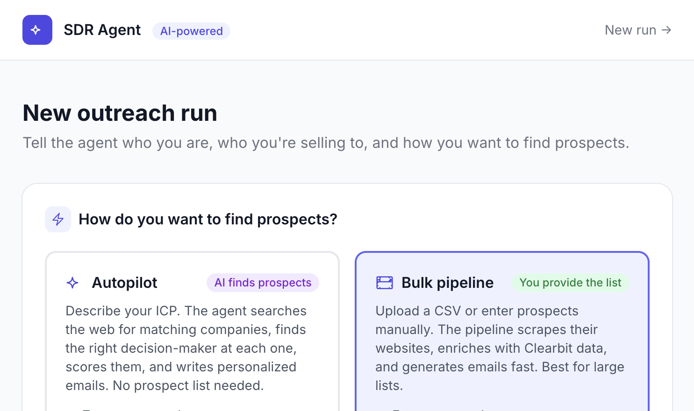
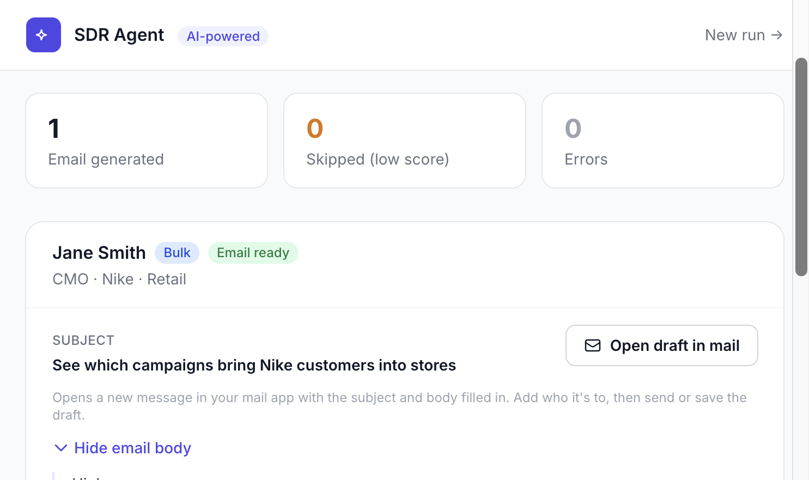
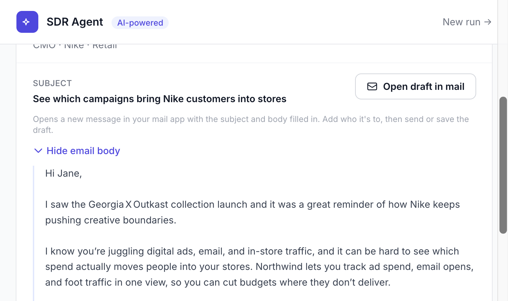

# AI Sales Outreach Agent

Drafts a personalized B2B cold email from your product and a prospect's website, instead of a mail merge with the company name swapped in.

Built with FastAPI, Tailwind CSS, Groq, and the Claude Agent SDK.

## Demo

A bulk run for Jane Smith, CMO at Nike. The email mentions a real collection on Nike's site, and **Open draft in mail** starts a message in your mail app with the subject and body filled in.







Subject from that run: **See which campaigns bring Nike customers into stores**

## Modes

- **Autopilot.** You describe the ideal customer. Claude finds real prospects, scores them, and writes emails. Needs `ANTHROPIC_API_KEY`. A few minutes per run.
- **Bulk.** You paste a short list or upload a CSV. Groq writes an email for each row from the prospect's homepage. No scoring. Needs `GROQ_API_KEY`. Seconds per prospect.

The form asks for your company website. If you leave "What your product does" blank, the app reads that page and uses it.

## How to run it

```bash
git clone https://github.com/sanginimehta/AI-SDR.git
cd AI-SDR
pip install -r requirements.txt
cp .env.example .env
uvicorn webapp.main:app --reload
```

Open `http://localhost:8000`.

Put `GROQ_API_KEY` in `.env` before a bulk run. Put `ANTHROPIC_API_KEY` in `.env` before autopilot. `CLEARBIT_API_KEY` is optional and adds company facts (industry, size, location) when it is set.

To try bulk: choose **Bulk pipeline**, fill in your company and ideal customer, add one prospect with a real website (or upload a CSV), then click **Generate emails**. CSV columns are `name, title, company, industry`, and optional `website`. A template is at `http://localhost:8000/sample-csv`.

`prospect_agent.py` is the original command-line scorer. It keeps a local note of emails it has already written so a later run can use a different angle. The web app does not do that yet.

## Files

- `webapp/` is the form, the run, the results page, and the CSV download.
- `core/pipeline.py` is bulk: scrape the homepage, then write the email with Groq (`openai/gpt-oss-20b`).
- `core/agent.py` is Claude: discover prospects, score them, and write the email.
- `core/output.py` turns model text into a subject and body, strips dash punctuation, and builds the mailto link.
